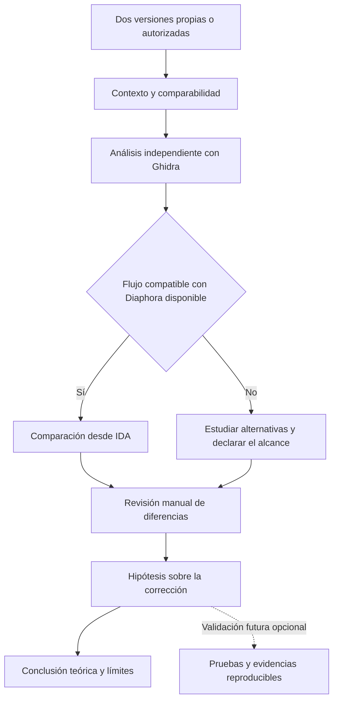

# Metodología conceptual de análisis

Este esquema representa decisiones de un analista, no resultados experimentales.

La representación no implica que Diaphora importe directamente proyectos de Ghidra.
