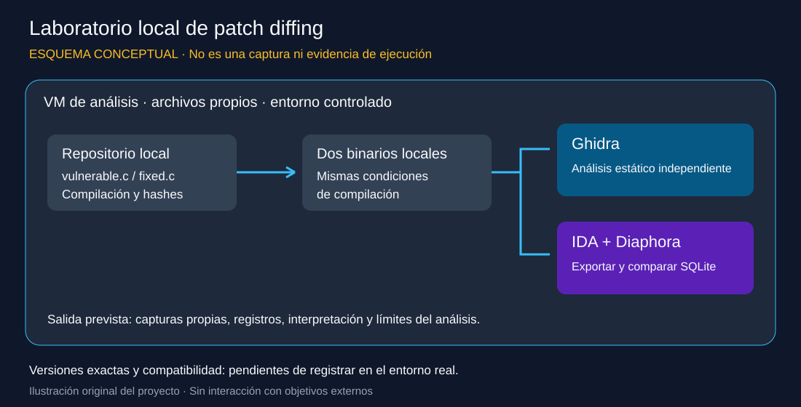
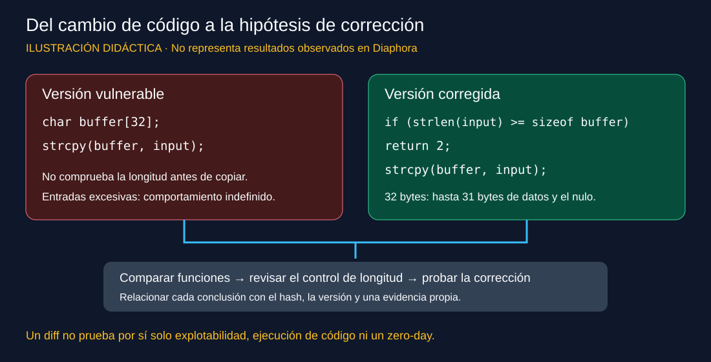

# Ilustraciones del laboratorio

Estos esquemas originales explican cómo se propone ejecutar el proyecto en un laboratorio local. Son ilustraciones conceptuales, no capturas de Ghidra o Diaphora ni evidencias de que se hayan realizado las pruebas. No sustituyen los registros y capturas propias solicitados en el informe.

## Entorno de análisis

Los mismos binarios propios se analizan por separado en Ghidra y en IDA con Diaphora. No se representa una integración directa de Diaphora en Ghidra. La edición de IDA y la versión del plugin deben ser compatibles.

## Cambio defensivo del ejemplo

La corrección propuesta valida la longitud antes de copiar. Las diferencias de ensamblador, direcciones, coincidencias y comportamiento observado deben documentarse tras compilar y analizar las muestras reales.

## Versiones

El autor indica que utiliza la última versión estable de los componentes. Declaración pendiente de completar con los números de versión instalados, edición de IDA, sistema operativo y fecha de ejecución. No implica que se haya verificado compatibilidad ni ejecución del laboratorio.

## Uso en el informe

Enlaza esta página desde la documentación o inserta los SVG con rutas relativas. Mantén siempre la indicación de que son esquemas ilustrativos. Las imágenes previas y los archivos de licencia no se modifican.
